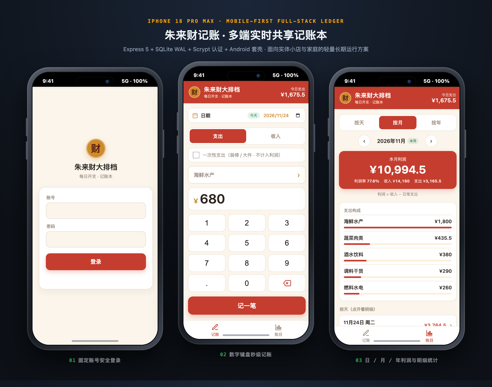

# 朱来财记账 · 面向小店与家庭的轻量多端共享记账系统

> 从给实体大排档解决真实每日收支与利润核算痛点演化而来的全栈记账应用——零构建前端、Express 5 + SQLite WAL 持久层、Scrypt 加盐认证，附带 PWA 与原生 Android 套壳源码，一台低配服务器即可长期稳跑。

<p align="center">
  
</p>

## 为什么做这个项目

很多实体小店、大排档或家庭记账面临两个现实问题：
- 市面通用记账 App 广告多、功能臃肿，而且不支持**多部手机实时共用同一本账**；
- 自己随便写的纯前端单页把数据存在 `localStorage`，换手机或清缓存账目直接归零。

**朱来财记账**用最克制的技术栈给出了一个可长期运行的工程答案：手机秒开、数字键盘 3 秒记一笔、老板与员工权限分离（老板看收入与利润率，员工仅记日常支出）、服务端 SQLite WAL 持久化，随时备份、随时迁移。

## 核心特性

- **多端实时共享同一本账**：无公开注册，固定账号通过 `.env` 配置，多台手机登录即同步。
- **老板 / 员工角色分级**：老板端支持收入、日常支出、一次性大额投入（装修/设备不计入日常利润）与分类管理；员工端仅开放支出记账。
- **日 / 月 / 年利润与支出构成**：自动汇总总收入、日常支出、净利润、利润率与分类占比条，按天展开明细。
- **移动端优先 + 双端交付**：原生响应式 HTML/CSS/ES Module（支持 PWA 添加到主屏幕），仓库内置 `android-app/` Android WebView 打包工程。
- **工程化长期运行**：`crypto.scrypt` 加盐密码哈希、会话令牌哈希入库、SQLite WAL 模式、优雅关闭与过期会话自动清理。

## 技术架构

| 层级 | 选型与说明 |
|---|---|
| 运行时 | Node.js ≥ 20 |
| Web 服务 | Express 5 |
| 数据库 | SQLite（`better-sqlite3`，WAL 模式，自动回退内置 `node:sqlite`） |
| 认证安全 | `crypto.scrypt` 加盐哈希 + 数据库会话令牌（仅存哈希） |
| 前端 | 原生 HTML / CSS / ES Module，零构建步骤，支持 PWA |
| 移动端壳 | `android-app/` 原生 Android WebView 工程 |

## 快速开始

```bash
# 1. 克隆并安装依赖
git clone https://github.com/huanghfzhufeng/zhulaicai-ledger.git
cd zhulaicai-ledger
npm install

# 2. 复制环境变量模板并配置账号
cp .env.example .env
# 编辑 .env，设置端口、老板/员工账号与初始密码

# 3. 启动服务
npm start
```

启动后访问 `http://127.0.0.1:3000` 即可使用。生产环境部署（Nginx / PM2 / HTTPS / Android APK 打包）详见 [DEPLOY.md](./DEPLOY.md)。

## 目录结构

```text
├── public/          # 移动端优先前端（登录、记账、统计、PWA）
├── src/             # Express 5 服务端、认证中间件、SQLite 数据层
├── android-app/     # Android WebView 套壳工程源码
├── deploy/          # 服务器初始化脚本
├── test/            # 后端与接口测试
└── DEPLOY.md        # 生产环境部署与打包说明
```
